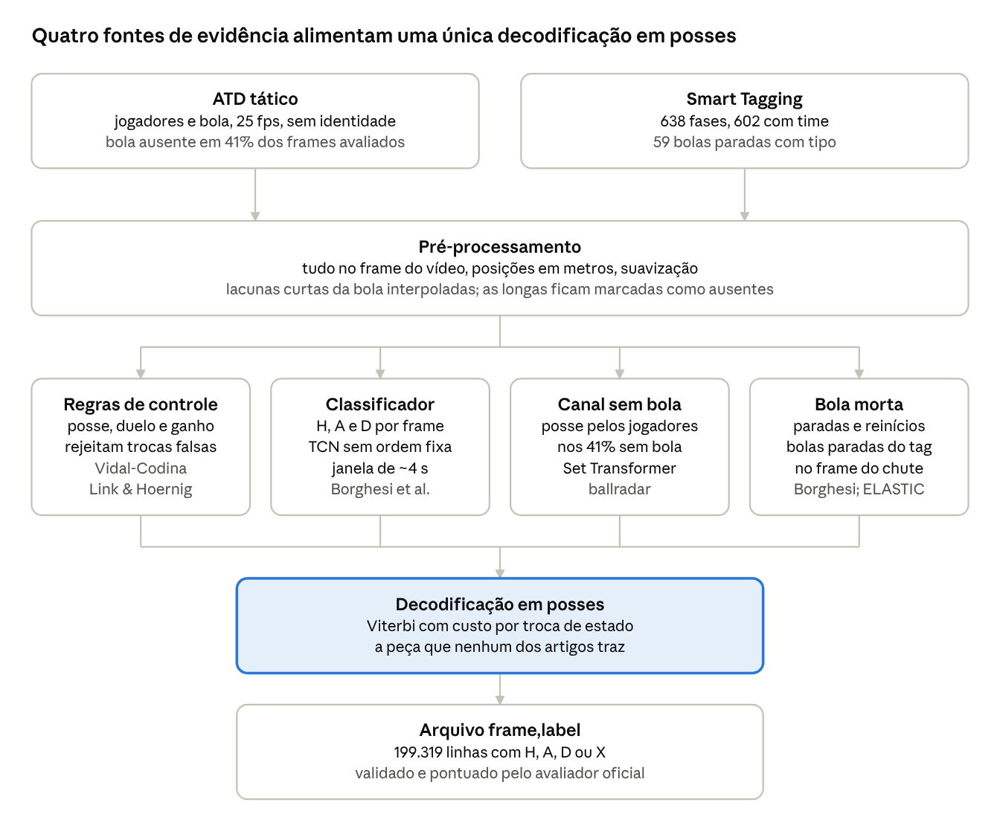
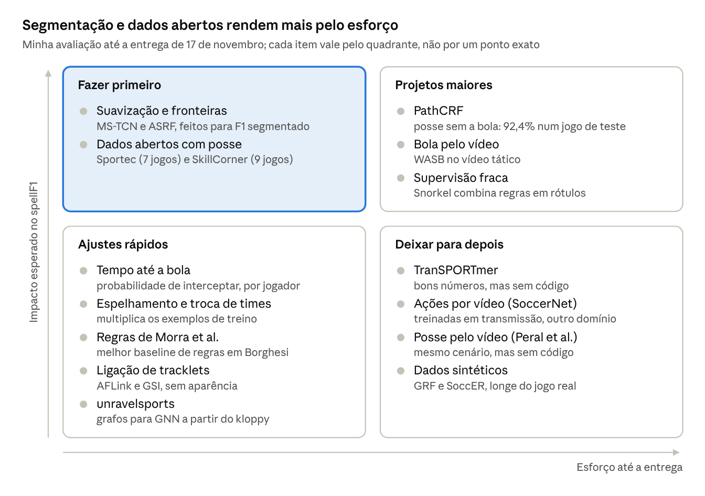

# Análise dos artigos sobre posse de bola

Oct 21, 2026 · @Pedro Araujo

Este documento resume cinco artigos sobre posse de bola e outros 14 candidatos encontrados depois, e explica como cada um pode ajudar no desafio do More Than A Hack 2027. Os termos técnicos estão explicados no glossário, logo depois da seção sobre o desafio.

## O desafio em resumo

O que mais pesa na escolha do modelo é a métrica do ranking. O ranking usa o spellF1, que avalia posses inteiras, e não frames isolados. Por isso, um modelo que acerta muitos frames, mas cria trocas de posse curtas que não existiram, fica mal colocado.

- **Tarefa.** O sistema precisa dar um rótulo a cada um dos 199.319 frames do vídeo tático, que tem 25 frames por segundo. O rótulo é H quando o Barcelona, time da casa, tem a bola; A quando o Athletic, visitante, tem a bola; D quando a bola está fora de jogo, o que se chama de bola morta; e X quando o sistema prefere não responder. Só contam para a nota os 158.857 frames dos dois tempos de jogo.
- **De onde vem a resposta certa.** O ground truth, isto é, a resposta usada para dar a nota, é calculado de forma automática a partir do tracking corrigido pela Metrica. Um frame é D quando esse tracking marca a bola como morta; nos demais, o rótulo é o time que o tracking aponta como dono da bola. Os rótulos não vieram de alguém assistindo ao vídeo, e nada foi suavizado depois.
- **Quando a posse troca de time.** A posse só troca quando um jogador do outro time ganha a bola com controle. Um toque sem controle, um desvio que não intercepta o passe ou um duelo aéreo ganho sem domínio posterior não trocam a posse. Quando a bola está disputada ou solta, a posse continua com o último time que a tinha.
- **Exemplo público.** O repositório traz só 5 minutos rotulados, do frame 11.185 ao 18.684, com 17 posses de 14,2 s em média. Esse trecho é o único lugar onde se pode ver como o tracking corrigido define o dono da bola em cada situação.
- **Dados com ruído.** O tracking entregue aos participantes é automático e não foi corrigido. Ele não identifica os jogadores: há 46 slots, que são colunas de dados, para 22 jogadores, e um slot pode sumir ou passar a seguir outra pessoa. A bola falta em 41% dos frames avaliados, sobretudo nos lances disputados, e vem só com as coordenadas x e y, sem a altura.
- **Smart Tagging.** É uma anotação automática da Metrica com 638 fases do jogo, das quais 59 são bolas paradas com o tipo marcado. O time vem marcado em 602 delas; as 36 marcadas como N/A incluem todos os arremessos laterais. Uma fase não é uma posse: ela pode cobrir só parte de uma posse ou se estender por duas.
- **Piso a superar.** O baseline oficial atribui cada frame ao time do jogador mais próximo da bola e depois aplica uma votação por maioria numa janela de ±2 s. Ele tem spellF1 de 0,2433 e macroF1 de 0,6724. Quando só o tamanho da janela muda, o macroF1 varia 0,04 e o spellF1 varia cinco vezes, o que mostra que as duas métricas medem coisas diferentes.
- **Validação.** Nos 5 minutos públicos, a janela de ±5 s parece a melhor, com spellF1 de 0,4242 contra 0,3256 da janela de ±2 s, mas no jogo inteiro ela perde. Ou seja, esse trecho serve para conferir se o sistema funciona, e não para escolher entre duas versões dele.
- **Regras.** Vale qualquer método que os organizadores consigam inspecionar e que esteja documentado. Rotular à mão um pouco de dado para treinar ou validar um modelo é permitido, mas o arquivo enviado precisa sair do algoritmo e ser reproduzível a partir do código.
- **Termos de uso.** Os termos proíbem enviar vídeos, dados ou trechos deles a modelos de linguagem hospedados na nuvem, o que inclui o Claude. Por isso, não abri a pasta do Drive, e esta análise usa só o repositório público.

O spellF1 compara posses previstas com posses reais. Cada posse prevista forma par com no máximo uma posse real, e o par só conta como acerto se os dois trechos se sobrepuserem o bastante, segundo a IoU. O F1 é calculado em cinco níveis de exigência de IoU, de 0,3 a 0,7, e o spellF1 é a média desses cinco valores:

```latex
\text{spellF1} = \frac{1}{5} \sum_{\tau \in \{0{,}3;\ 0{,}4;\ 0{,}5;\ 0{,}6;\ 0{,}7\}} F_1(\tau), \qquad \text{IoU}(p, g) = \frac{|p \cap g|}{|p \cup g|}
```

Na prática, um atraso de 1 frame em todas as trocas não muda a nota, mas um atraso de 1 s reduz o spellF1 para 0,65. O rótulo X também tem um efeito próprio: antes de calcular o spellF1, o avaliador substitui cada X pelo último rótulo dado. Por isso, responder X no meio de uma posse não custa nada, mas responder X numa troca de posse faz o rótulo antigo continuar valendo depois da troca.

## Glossário

Estes são os termos técnicos que aparecem no documento, agrupados por tema: dados, métricas e modelos.

| Termo | O que significa |
| --- | --- |
| Frame | Cada imagem do vídeo. O vídeo tático tem 25 frames por segundo, e o desafio pede um rótulo para cada frame. |
| Tracking | Dados com a posição de cada jogador e da bola em cada frame, extraídos do vídeo por um sistema automático. |
| ATD | Nome que a Metrica dá ao tracking automático entregue no desafio. Esses dados não foram corrigidos por pessoas. |
| Slot | Cada coluna de jogador no ATD. Um slot não corresponde a um jogador fixo: ele aparece, some e pode passar a seguir outra pessoa. |
| Tracklet | Trecho contínuo da trajetória de um jogador, do momento em que o sistema o encontra até o momento em que o perde. |
| Homografia | Transformação que converte uma posição no gramado em um pixel da imagem, e o contrário. Só funciona para pontos no plano do gramado. |
| Smart Tagging | Anotação automática da Metrica que marca fases do jogo, como construção e transição, e bolas paradas, quase sempre com o time. |
| Ground truth | A resposta certa usada para dar a nota. No desafio, sai do tracking corrigido pela Metrica. |
| Rótulo | A resposta associada a cada frame: H, A, D ou X. Em aprendizado de máquina, também é a resposta certa usada para treinar um modelo. |
| Baseline | Método de referência simples, usado como piso que os outros métodos precisam superar. |
| Pipeline | Sequência de etapas de processamento, dos dados brutos até o arquivo final de resposta. |
| Precisão e recall | Precisão é a fração das respostas dadas que estão certas. Recall é a fração das respostas certas que o sistema conseguiu encontrar. |
| F1 | Média harmônica entre precisão e recall. Vai de 0 a 1 e só fica alto quando as duas são altas. |
| macroF1 | F1 calculado frame a frame para cada estado (H, A e D), seguido da média simples dos três valores. |
| IoU | Interseção sobre união: a duração que dois trechos têm em comum dividida pela duração total que eles cobrem juntos. Vale 1 quando os trechos coincidem e 0 quando não se tocam. |
| spellF1 | F1 calculado sobre posses inteiras: uma posse prevista só conta como acerto se tiver IoU suficiente com uma posse real. É a métrica do ranking. |
| F1@k | F1 por trechos usado em segmentação de vídeo: um trecho previsto e um real formam par quando a IoU entre eles passa de k%. É da mesma família do spellF1. |
| Rede neural | Modelo que aprende uma tarefa a partir de exemplos com a resposta certa, ajustando muitos parâmetros internos. |
| Treino e pré-treino | Treino é o ajuste do modelo com exemplos rotulados. Pré-treino é um primeiro treino em outros dados, mais abundantes, antes do ajuste final nos dados do problema. |
| TCN | Rede convolucional temporal: rede neural que lê uma sequência aplicando filtros sobre frames vizinhos, que alcançam frames cada vez mais distantes a cada camada. |
| Atenção e transformer | Atenção é um mecanismo que deixa cada elemento, como um jogador ou um frame, pesar a importância dos outros. Transformer é uma rede neural construída com camadas de atenção. |
| Bi-LSTM | Rede recorrente que lê uma sequência nos dois sentidos do tempo, do início para o fim e do fim para o início. |
| Indiferença à ordem | Propriedade de um modelo cujo resultado não muda quando a ordem dos jogadores na entrada muda. Também se chama invariância à permutação. |
| GNN | Rede neural de grafos: trata cada jogador como um nó e as relações entre jogadores como ligações entre os nós. |
| Classificador por frame | Modelo que dá, para cada frame, a probabilidade de cada estado (H, A e D). |
| Viterbi | Algoritmo que escolhe a sequência de estados mais provável quando trocar de estado tem um custo. Ele transforma probabilidades por frame em trechos contínuos. |
| HMM e CRF | Modelos de sequência que combinam a evidência de cada frame com a chance de passar de um estado para outro. Nos dois, o Viterbi encontra a melhor sequência. |
| Supervisão fraca | Treino de um modelo com rótulos gerados por regras imperfeitas, chamados pseudo-rótulos, em vez de rótulos feitos à mão. |
| GBDT | Conjunto de árvores de decisão treinadas em sequência, em que cada árvore corrige os erros das anteriores. O LightGBM é uma implementação conhecida. |
| Spline | Curva suave que passa por pontos conhecidos. Serve para preencher lacunas curtas numa trajetória. |
| Mudança de domínio | Diferença entre os dados em que um modelo foi treinado e os dados em que ele é usado, como vídeo de TV e vídeo tático. Costuma piorar o desempenho. |

## Link & Hoernig (2017)

[Individual ball possession in soccer](https://pmc.ncbi.nlm.nih.gov/articles/PMC5503225), PLOS ONE.

**Em resumo:** os autores detectam, a partir do tracking, quando cada jogador está com a bola e se ele a domina ou só a toca. Essa distinção entre domínio e toque é exatamente a que o desafio usa para decidir se a posse trocou de time. O método, porém, depende de limiares ajustados a dados em que a bola está bem rastreada, o que não acontece no desafio.

### O que o artigo faz

- **Dados.** Os autores usaram 60 jogos da Bundesliga com tracking óptico da TRACAB, a 25 frames por segundo. Eles usaram só as coordenadas x e y da bola, sem a altura.
- **Quando começa uma ação com a bola.** O método detecta um chute quando a aceleração da bola tem um pico acima de 4 m/s². A bola é atribuída a um jogador quando entra na área que ele consegue alcançar, mesmo antes do primeiro toque.
- **Quando termina uma ação com a bola.** A ação de um jogador termina quando ele já não consegue alcançar, dentro de 1 s, a posição que a bola deve ocupar.
- **Domínio ou toque.** Uma rede bayesiana, modelo estatístico que combina várias evidências numa probabilidade, classifica cada intervalo como domínio da bola ou toque sem domínio. Ela acertou 97,0% dos intervalos com domínio, mas só 50% dos intervalos sem domínio. A acurácia total foi de 96,7%, alta porque os domínios são muito mais comuns que os toques.
- **Validação.** Um observador treinado anotou cinco jogos, e o método foi comparado a essa anotação com tolerância de 0,6 s. A melhor forma de detectar as ações chegou a F1 de 0,88. Como referência, dois anotadores humanos concordaram com κ de 0,72, numa escala em que 1 é concordância total e 0 é a concordância esperada por acaso.
- **Bola parada.** Quando a bola não está em jogo, o método não atribui posse a ninguém, o que corresponde ao D do desafio. Para saber se a bola está em jogo, o artigo usa uma marcação fornecida pelo provedor do tracking.
- **Duração típica.** Um domínio individual dura em média 1,2 s, com desvio padrão de 1,0 s.

### Como se relaciona com o desafio

- **O critério de domínio é o mesmo do desafio.** O desafio só troca a posse quando o outro time domina a bola, e o artigo separa domínio de toque sem domínio. Por isso, ele é o melhor ponto de partida para um filtro que rejeite trocas de posse falsas.
- **A posse de um time dura muito mais que a de um jogador.** Um domínio individual dura cerca de 1,2 s, e uma posse de time no exemplo público dura 14,2 s em média. Uma posse de time é, portanto, uma sequência de domínios de jogadores do mesmo time, e o sistema só deveria trocar de time quando houver evidência de domínio do adversário.
- **O método supõe que a bola está quase sempre rastreada.** No desafio, a bola falta em 41% dos frames avaliados. Além disso, a aceleração da bola, que o método usa para detectar chutes, fica ruidosa se a trajetória não for suavizada antes.
- **O desafio não fornece a marcação de bola em jogo.** O artigo usa essa marcação, mas o ATD do desafio não a tem, e ela precisaria ser estimada.
- **O desempenho de referência é fraco.** Na reimplementação de Borghesi et al. (2023), o método acertou a posse em 64,5% dos frames, o pior resultado entre os métodos de regras comparados. Esse número deve ser lido com cuidado, porque os parâmetros vieram de outro conjunto de dados.
- **Uso sugerido.** Duas ideias do artigo valem a pena: o detector de chute pelo pico de aceleração da bola, como sinal de uma possível troca de posse, e o classificador de domínio, como filtro para confirmar ou rejeitar essa troca.

## Borghesi et al. (2023)

[Using Temporal Convolutional Networks to estimate ball possession in soccer games](https://iris.polito.it/retrieve/8cc27103-7ee0-4243-8a04-0b256f77ad39/eswa_tcn_authors_accepted_version.pdf), Expert Systems with Applications 223, 119780.

**Em resumo:** os autores treinaram uma rede neural que diz, a cada frame, se a bola está morta, com o time da casa ou com o visitante. São os mesmos três estados que o desafio pede (D, H e A). A rede acertou a posse em 86,2% dos frames, cerca de 7 pontos percentuais acima do melhor método de regras fixas. O artigo, porém, só mediu acertos frame a frame, enquanto o desafio é ranqueado por posses inteiras.

### O que o artigo faz

- **Dados.** Os autores usaram 8 jogos de uma liga europeia de primeira divisão, da temporada 2019-20, gravados a cerca de 16 frames por segundo. Quatro jogos serviram para treinar a rede, dois para ajustá-la e dois para testá-la.
- **Rótulos.** Um operador humano marcou, em tempo real, o estado da bola ao longo de cada jogo, e os autores avisam que esse tipo de marcação tem erros. Nos dados, cerca de 40% dos frames são de bola morta, 29,6% de posse da casa e 30,3% de posse do visitante.
- **O que a rede recebe.** Para decidir sobre um frame, a rede olha uma janela de 64 frames, cerca de 4 segundos. O frame avaliado fica na posição 48 da janela, então a rede também vê cerca de 1 segundo do que acontece depois dele. Em cada frame, ela recebe a posição e a velocidade de 36 objetos (bola, árbitro, 22 titulares e 12 reservas), além do time de cada jogador e de uma marcação de dado ausente.
- **Bola ausente.** Quando a posição da bola falta, os autores preenchem o trecho com uma curva suave que passa pelos pontos conhecidos (spline de Akima). Quando não há como preencher, a rede recebe a marcação de que a bola está ausente.
- **Arquitetura.** Cada objeto passa por uma rede convolucional temporal (TCN), um tipo de rede neural que lê uma sequência ao longo do tempo. Em seguida, uma camada de atenção, que pesa a importância de cada objeto em relação aos outros, combina os 36 objetos de um jeito que não depende da ordem em que eles aparecem na entrada. Assim, o resultado não muda se dois jogadores trocarem de coluna nos dados.
- **Resultados.** A rede acertou a posse em 86,2% dos frames de teste e acertou se a bola estava viva ou morta em 89,2% deles. Os métodos de regras fixas, reimplementados pelos autores, acertaram a posse em 79,1% (Morra et al., 2020), 75,4% (Khaustov e Mozgovoy, 2020) e 64,5% (Link & Hoernig, 2017). Para bola viva ou morta, o melhor método anterior era uma árvore de decisão que olhava só a bola, com 56,0% de acerto.

### Como se relaciona com o desafio

- **A arquitetura pode ser reaproveitada, mas o modelo treinado no artigo, não.** No artigo, quem define a posse é um operador humano; no desafio, é o tracking corrigido da Metrica. As duas definições podem discordar justamente nos momentos de troca de posse, e são esses momentos que decidem o spellF1.
- **No desafio, a rede precisa ser indiferente à ordem dos jogadores.** O tracking do desafio tem 46 slots, que são colunas de dados sem um jogador fixo: elas aparecem, somem e trocam de pessoa ao longo do jogo. Além disso, o artigo supõe 36 objetos com papéis fixos, como goleiro e árbitro, e o tracking do desafio não marca esses papéis. Por isso, a rede teria de tratar cada time como um conjunto de pontos, sem lugares fixos.
- **A janela precisa ser convertida para 25 frames por segundo.** Os 64 frames do artigo cobrem cerca de 4 segundos porque os dados dele tinham 16 fps. No desafio, que tem 25 fps, os mesmos 4 segundos correspondem a cerca de 100 frames. Vale manter a parte da janela que fica depois do frame avaliado, porque ela ajuda a marcar a troca de posse sem atraso. O spellF1 cai rápido com atraso: com 1 s de atraso em todas as trocas, ele vai a 0,65.
- **O maior obstáculo é a falta de rótulos para treinar.** O artigo treinou com 4 jogos inteiros rotulados, e o desafio oferece só 5 minutos rotulados, com 17 posses. A seção “O que os artigos sugerem para o pipeline” lista as alternativas.
- **Acertar a maioria dos frames não garante acertar as posses.** Um classificador que acerta 86% dos frames ainda pode trocar de time por poucos frames, várias vezes, dentro de uma mesma posse. Cada uma dessas trocas cria posses falsas. O baseline do desafio mostra o efeito: tem macroF1 de 0,6532, que mede acerto por frame, e spellF1 de apenas 0,0486, que mede acerto por posse. Por isso, as probabilidades que a rede dá a cada frame precisam passar por uma etapa que as transforme em posses contínuas.
- **O ganho mais claro está na detecção de bola morta.** O acerto em bola viva ou morta subiu de 56,0%, com um método que olhava só a bola, para 89,2%, com uma rede que olha também os jogadores. Isso sugere que o movimento dos jogadores revela as paradas; o próprio repositório do desafio observa que, nas paradas, os jogadores caminham e a bola fica parada. Esse é o ponto mais fraco do baseline oficial, que só marca bola morta quando perde a bola de vista.
- **Uso sugerido.** Esse modelo pode ser o classificador central de uma segunda versão do sistema. Ele daria, a cada frame, a probabilidade de H, de A e de D, e uma etapa seguinte transformaria essas probabilidades em posses.

## Vidal-Codina et al. (2022)

[Automatic event detection in football using tracking data](https://arxiv.org/pdf/2202.00804v3), Sports Engineering 25, 18.

**Em resumo:** os autores detectam eventos do jogo, como passes, chutes e bolas paradas, usando só o tracking e um conjunto de regras fixas. Antes de detectar os eventos, o método decide a cada frame qual jogador está com a bola, com regras explícitas para posse, disputa e ganho de controle. Entre os artigos, essas são as regras mais detalhadas para decidir quando a posse troca de time. O artigo não publica código, mas a biblioteca DataBallPy implementa a parte de posse.

### O que o artigo faz

- **Dados.** Os autores usaram 31 jogos de três provedores de tracking (Track160, TRACAB e Hawk-Eye), todos a 25 frames por segundo, e só as coordenadas x e y da bola.
- **Zona de posse.** Cada jogador tem um círculo em volta dele, de 0,5 m num provedor e de 1 m nos outros dois. Quando a bola está dentro desse círculo, o jogador é considerado com a bola.
- **Zona de disputa.** Há também um círculo de 1 m em volta da bola, que o artigo chama de zona de duelo. Quando há jogadores dos dois times dentro dele, o método marca uma disputa, que tem prioridade sobre a posse.
- **Ganho e perda.** Para que um jogador ganhe a bola, ela precisa mudar de direção ou de velocidade dentro da zona dele. Para que ele perca a bola, ela precisa sair da zona com um deslocamento acima de um limite. Quando a bola passa pela zona sem essas mudanças, o método descarta o lance como falso positivo. Os valores desses limites estão no material suplementar do artigo (Online Resource 1), que não acompanha a versão do arXiv.
- **Bola morta.** O método marca bola morta pela indicação do provedor ou, quando ela não existe, pela ausência da bola nos dados.
- **Eventos.** Depois de decidir a posse, uma árvore de regras classifica cada perda e cada ganho de bola: bola parada, chute, cruzamento, passe, recepção ou interceptação. Passes e a maioria das bolas paradas tiveram mais de 90% de precisão e de recall; chutes tiveram 78% de precisão e 53% de recall.
- **Custo.** O método roda em cerca de 3 minutos por jogo num processador comum. Os autores não mediram a acurácia da posse em si.

### Como se relaciona com o desafio

- **As regras de ganho traduzem o “controle” do desafio em código.** O desafio só troca a posse quando há controle da bola, e o artigo só aceita um ganho quando a bola muda de direção ou de velocidade perto do jogador. A zona de disputa identifica a bola disputada, que no desafio continua com o último time que a tinha.
- **O artigo para no nível do jogador.** Ele decide qual jogador tem a bola, mas deixa a posse de time como trabalho futuro. A passagem de jogadores para posses de time, que é o que o spellF1 avalia, precisa ser construída à parte.
- **Uma interceptação é uma troca de posse.** A árvore de regras distingue recepção de interceptação pela perda anterior: se a bola veio de um companheiro, é recepção; se veio de um adversário, é interceptação. No desafio, uma interceptação é exatamente uma troca de posse.
- **Bloqueios exigem cuidado.** O artigo registra um bloqueio como perda da bola seguida de ganho de quem bloqueou. No desafio, um bloqueio só troca a posse se o time de quem bloqueou dominar a bola depois.
- **A regra de bola morta do artigo não serve aqui.** Tratar bola ausente como bola morta é exatamente o que o baseline oficial faz, e o repositório do desafio atribui a isso a fraqueza da classe D dele. A bola falta em 41% dos frames avaliados, e some sobretudo em lances disputados, com a bola em jogo.
- **Os raios precisam ser recalibrados.** Círculos de 0,5 a 1 m supõem posições precisas, e o tracking automático do desafio tem ruído e jogadores duplicados. A DataBallPy usa 1,5 m como padrão, e os próprios autores avisam que tracking extraído de vídeo de transmissão exigiria reajustar os parâmetros. Calibrar os raios nos 5 minutos públicos exige cuidado para não ajustar demais o sistema a esse trecho.
- **O artigo ajuda a identificar o time que reinicia o jogo.** Ele reconhece saída de bola, pênalti, tiro de meta, escanteio e arremesso lateral pela posição dos jogadores durante a parada. O time do jogador que cobra define a primeira posse depois da parada, inclusive nos laterais, que o Smart Tagging deixa sem time. Como o ATD não marca a bola em jogo, o instante do reinício precisa vir de outro sinal, como o pico de aceleração da bola.
- **Uso sugerido.** Um baseline de regras forte pode ser montado sobre a [DataBallPy](https://databallpy.readthedocs.io/en/main/features/team_and_player_possession.html), que usa por padrão raio de posse de 1,5 m, limite de velocidade da bola de 5 m/s e limite de ângulo de 10°.

## Kim et al. (2023), ballradar

[Ball Trajectory Inference from Multi-Agent Sports Contexts Using Set Transformer and Hierarchical Bi-LSTM](https://arxiv.org/pdf/2306.08206), KDD 2023.

**Em resumo:** os autores estimam onde está a bola e quem está com ela usando só as posições e velocidades dos jogadores, sem nenhum dado da bola. O modelo acertou o time com a bola em 85,85% dos casos. Por isso, ele é o candidato mais direto para os 41% de frames do desafio em que a bola não aparece no tracking.

### O que o artigo faz

- **Dados.** Os autores usaram 15 jogos da liga coreana com dados de GPS da empresa Fitogether, que não são públicos, e os 3 jogos de amostra públicos da Metrica Sports. Os dados da Metrica, gravados a 25 frames por segundo, foram reduzidos para 10 frames por segundo.
- **O que o modelo recebe.** O modelo recebe janelas de 10 segundos com os 22 jogadores: a posição, a velocidade em cada direção, o módulo da velocidade e a aceleração de cada um. A bola não faz parte da entrada; ela é o que o modelo precisa estimar.
- **Arquitetura.** Primeiro, um Set Transformer, um tipo de transformer feito para conjuntos, resume a situação dos jogadores sem depender da ordem deles. Depois, redes Bi-LSTM, que leem a sequência nos dois sentidos do tempo, trabalham em duas etapas: a primeira estima qual jogador tem a bola, e a segunda estima a trajetória da bola a partir disso.
- **Restrições físicas.** Durante o treino, uma penalidade desencoraja o modelo a mudar a direção da bola quando não há jogador perto dela. Depois do modelo, uma etapa de regras fixa a bola na posição dos jogadores que a tocam e liga esses pontos por linhas retas.
- **Resultados.** A bola estimada ficou, em média, a 3,66 m da bola real. O modelo acertou o jogador com a bola em 64,7% dos casos e o time com a bola em 85,85%.
- **Código.** O repositório [pientist/ballradar](https://github.com/pientist/ballradar) traz o código de treino e de avaliação, mas não traz modelos já treinados nem uma licença visível.

### Como se relaciona com o desafio

- **O modelo pode cobrir os frames sem bola pela posse, e não pela posição da bola.** O erro médio de cerca de 3,7 m é grande demais para descobrir o jogador mais próximo da bola, porque os raios de posse usados nas regras são de 1 a 1,5 m. Já a probabilidade de cada jogador estar com a bola é uma evidência direta, que pode ser usada nos frames em que a bola não aparece.
- **O movimento dos jogadores contém muita informação sobre a posse.** O modelo acertou o time com a bola em 85,85% dos casos sem ver a bola, na mesma faixa dos 86,2% que Borghesi et al. obtiveram vendo a bola, ainda que com dados e rótulos diferentes. Isso justifica ter no sistema uma parte que olha só os jogadores.
- **O modelo precisa de adaptação para o ATD.** As redes Bi-LSTM do artigo acompanham cada jogador numa coluna fixa durante 10 s. No ATD, os slots trocam de pessoa, e há cerca de 20,5 objetos rastreados por frame em vez de 22. Três saídas possíveis são usar janelas mais curtas, ligar antes os trechos de trajetória de cada jogador (ver “Rastreamento”, mais abaixo) ou resumir os jogadores como um conjunto a cada frame antes da parte temporal.
- **Os dados de treino têm formato próximo ao do desafio.** O ballradar já usa os jogos de amostra públicos da Metrica, com a posse calculada a partir de eventos anotados por pessoas. É o caminho mais curto para pré-treinar o modelo fora do jogo do desafio.
- **A definição de posse é diferente.** No ballradar, a posse vem de eventos anotados por pessoas; no desafio, vem do tracking corrigido. Por isso, seria preciso um ajuste final nos 5 minutos públicos, com validação cuidadosa.

## ELASTIC (2025)

[ELASTIC: Event-Tracking Data Synchronization in Soccer Without Annotated Event Locations](https://arxiv.org/html/2508.09238v1), de pesquisadores do KAIST, da Fitogether e do AFC Ajax.

**Em resumo:** o ELASTIC corrige o instante de eventos anotados por pessoas, como passes e chutes, procurando no tracking o frame exato em que cada um aconteceu. Dos cinco artigos, é o que menos se ajusta aos dados do desafio, porque precisa de eventos com o jogador que os executou, e o Smart Tagging só traz fases do jogo. O que se aproveita é a forma de achar o frame exato de um chute ou de um reinício.

### O que o artigo faz

- **Problema.** Eventos anotados por pessoas, como passes, cruzamentos, chutes, bolas paradas, recepções e desarmes, costumam ter o horário registrado com algum atraso ou adiantamento. O ELASTIC corrige esse horário usando só o tracking, sem precisar da posição anotada do evento.
- **Etapas.** Primeiro, o método alinha o pontapé inicial nos dois tipos de dado. Depois, sincroniza os eventos principais, como passes e chutes, detecta as recepções e, por fim, sincroniza eventos menores, como desarmes e faltas.
- **Entrada.** O método precisa dos eventos com jogador, tipo e resultado. Do tracking, precisa das coordenadas x e y dos jogadores, das coordenadas x e y e da altura da bola, e da marcação de bola viva ou morta.
- **Sinais usados.** Para achar o frame de cada evento, o método olha a distância entre o jogador e a bola, a distância do jogador mais próximo, a aceleração da bola suavizada, os momentos em que a altura da bola é mínima e a distância que a bola percorre antes e depois do evento.
- **Resultados.** Em 2.134 eventos de três jogos da liga holandesa de 2024-25, o ELASTIC acertou o frame exato do início do evento em 88,4% dos casos, contra 21,1% do método anterior, o ETSY. Nos eventos do tipo passe, acertou 95,5%.
- **Código.** O código está em [hyunsungkim-ds/elastic](https://github.com/hyunsungkim-ds/elastic), com um tutorial nos dados abertos da Sportec. Existe uma [versão de agosto de 2026](https://arxiv.org/pdf/2608.30227) do artigo no arXiv, cujo texto não consegui ler.
- **Posse.** O artigo não trata de posse de bola.

### Como se relaciona com o desafio

- **O Smart Tagging não é um conjunto de eventos.** Ele traz fases do jogo e bolas paradas com o time, mas sem o jogador e sem eventos individuais, como passes. Por isso, o ELASTIC não funciona sobre ele como está.
- **Faltam três entradas no ATD.** O ATD do desafio não tem a altura da bola, a identidade dos jogadores nem a marcação de bola viva ou morta, e o ELASTIC usa as três.
- **A parte aproveitável é achar o frame exato dos reinícios.** As 59 bolas paradas do Smart Tagging podem ser ajustadas ao frame do chute que reinicia o jogo, usando o pico de aceleração da bola e a distância ao jogador mais próximo. Esse frame marca a passagem de D para H ou A. O spellF1 é sensível a esse instante: com 1 s de atraso em todas as trocas, ele cai para 0,65.
- **Gerar rótulos de posse a partir do Smart Tagging exige cuidado.** O próprio repositório do desafio avisa que fases não são posses e que o time falta em todos os arremessos laterais. O Smart Tagging serve como evidência para o modelo, e não como rótulo pronto.

## Comparativo

Cada artigo resolve uma parte do problema, e nenhum deles avalia posses inteiras como o spellF1 faz. A tabela abaixo ordena os artigos do mais importante para o menos importante para o sistema proposto.

| Artigo | Abordagem | Rótulos de treino | Bola ausente | Bola morta | Código | Papel no desafio |
| --- | --- | --- | --- | --- | --- | --- |
| Borghesi et al. (2023) | Rede neural treinada (TCN) | Precisa de muitos: jogos inteiros rotulados | Preenche lacunas e marca a ausência | Aprende com o movimento dos jogadores (89,2% de acerto) | Não publicado | Classificador central de H, A e D |
| Vidal-Codina et al. (2022) | Regras fixas | Não precisa | Trata como bola morta | Indicação do provedor ou bola ausente | Não publicado; a DataBallPy implementa a posse | Baseline de regras, trocas de posse e reinícios |
| Kim et al. (2023), ballradar | Rede neural treinada (Set Transformer e Bi-LSTM) | Precisa de muitos: jogos inteiros rotulados | Estima a bola a partir dos jogadores | Não trata | Publicado, sem modelos treinados | Cobrir os frames sem bola |
| Link & Hoernig (2017) | Regras e rede bayesiana | Poucos: para ajustar limiares e o classificador de domínio | Não trata | Indicação do provedor | Não publicado (só um arquivo de exemplo) | Filtro de domínio e detecção de chutes |
| ELASTIC (2025) | Busca do frame exato com sinais de movimento | Usa eventos anotados como entrada | Não trata | Indicação do provedor | Publicado | Achar o frame exato dos reinícios |

A etapa que transforma decisões por frame em posses contínuas, que é o que o ranking avalia, não aparece em nenhum dos cinco artigos e terá de ser construída à parte.

## O que os artigos sugerem para o pipeline

Os cinco artigos funcionam como fontes de evidência complementares: cada um ajuda a estimar, frame a frame, quem tem a bola ou se ela está morta. Falta, em todos eles, a etapa que converte essa evidência em posses com início e fim.



Cada uma das quatro fontes produz sinais ou probabilidades para cada frame. Só a etapa de decodificação, na parte de baixo do diagrama, transforma esses sinais em posses com início e fim, que é o que o spellF1 avalia.

### Segmentação em posses: a etapa que falta

A proposta a seguir é minha, e não dos artigos. A ideia é escolher, entre todas as sequências possíveis de estados, a que melhor combina as probabilidades de cada frame com um custo para cada troca de estado:

```latex
\hat{y}_{1:T} = \arg\max_{y_{1:T}} \left[ \sum_{t=1}^{T} \log p(y_t \mid x) - \sum_{t=2}^{T} c(y_{t-1}, y_t) \right]
```

Na fórmula, yₜ é o estado escolhido para o frame t (H, A ou D), e p(yₜ | x) é a probabilidade que o classificador dá a esse estado, considerando os dados de entrada x. Já c é o custo de passar de um estado para outro, que vale zero quando o estado se repete. A primeira soma favorece as sequências que concordam com o classificador, e a segunda penaliza cada troca. O algoritmo de Viterbi encontra a melhor sequência de forma exata e rápida.

- **Custos diferentes para trocas diferentes.** Um custo para trocar entre H e A e outro para entrar ou sair de bola morta permitem exigir mais evidência para uma troca de posse do que para uma parada. Isso faz sentido porque, no desafio, uma troca de posse exige que o adversário domine a bola.
- **É no custo de troca entre H e A que entram as regras dos artigos.** O critério de domínio de Link & Hoernig e as regras de ganho de Vidal-Codina podem reduzir esse custo quando há evidência de que o adversário dominou a bola, e aumentá-lo quando não há.
- **O rótulo X quase não será necessário.** A decodificação já mantém a posse durante os trechos em que a bola some, que é o mesmo efeito que o X teria no spellF1. Além disso, o X conta como erro no macroF1, que é o critério de desempate.

### Dados de treino

Os modelos que aprendem com exemplos rotulados, como o de Borghesi et al. e o ballradar, precisam de muitos rótulos, e o desafio fornece só 5 minutos rotulados. Estas são as fontes possíveis de rótulos:

1. **Os 5 minutos públicos.** São 7.500 frames com 17 posses. Eles servem para conferir se o sistema funciona e se a definição de posse está certa, mas são poucos para treinar um modelo.
2. **Rótulos feitos à mão em trechos do jogo.** As regras permitem rotular à mão, desde que seja só para treinar ou validar o modelo. A marcação precisa ser feita localmente, sem enviar os dados a modelos de linguagem na nuvem.
3. **Pseudo-rótulos.** Regras como as de Vidal-Codina, somadas às bolas paradas do Smart Tagging, podem rotular automaticamente os trechos em que elas são mais confiáveis. Esses rótulos imperfeitos servem para um primeiro treino do modelo.
4. **Dados públicos de outros jogos.** As principais opções são os jogos de amostra da Metrica, já usados pelo ballradar, e os 7 jogos abertos da Sportec. A seção “Outros modelos que podem contribuir” explica o que cada conjunto traz. Usar dados corrigidos deste mesmo jogo é proibido pelas regras.
5. **Ruído simulado.** Outra opção é aplicar a dados limpos o mesmo tipo de ruído do desafio: apagar a bola em cerca de 41% dos frames, sobretudo nas disputas, e quebrar as trajetórias dos jogadores, trocando as identidades entre slots. Assim, o modelo aprende com dados parecidos com os do desafio.

### Validação

- **É preciso validar com mais do que 5 minutos.** O repositório mostra que esse trecho escolhe a versão errada do próprio baseline. Para comparar versões do sistema, é preciso validar em dados externos ou em trechos do jogo rotulados à mão.
- **Diferenças pequenas podem ser só ruído.** No jogo inteiro, diferenças de spellF1 menores que 0,04 não indicam que uma versão é melhor que a outra. O avaliador calcula intervalos de confiança com a opção `--bootstrap 1000`, e, quando os intervalos de duas versões se sobrepõem, não dá para dizer qual delas é melhor.
- **Vale olhar a contagem de posses.** O script `validate_submission.py` mostra quantas posses o arquivo tem. Um número muito maior que o esperado, com muitas posses curtas, indica que falta a etapa de segmentação.

## Outros modelos que podem contribuir

Fora dos cinco artigos, encontrei 14 candidatos que podem ajudar. Na minha avaliação, três se destacam: o PathCRF, que estima a posse sem usar a bola; os modelos MS-TCN e ASRF, criados para uma métrica por trechos parecida com o spellF1; e conjuntos de dados abertos que trazem a posse marcada em cada frame. O mapa abaixo resume o impacto esperado e o esforço de cada candidato até a entrega de 17 de novembro.



O quadrante de cima à esquerda reúne o que melhora diretamente o spellF1 ou resolve a falta de rótulos com pouco código novo. O PathCRF e os métodos de vídeo podem trazer mais ganho, mas exigem identidade estável dos jogadores, placa de vídeo (GPU) e adaptação a dados diferentes dos de treino.

### Posse sem a bola

- **[PathCRF](https://arxiv.org/pdf/2602.12080)** (Kim et al., KDD 2026). O PathCRF reconstrói o caminho da bola usando só as trajetórias dos jogadores. A cada instante, ele escolhe entre duas situações: um jogador está com a bola, ou a bola está indo de um jogador para outro. Um CRF, modelo de sequência explicado no glossário, proíbe passagens impossíveis: por exemplo, depois que a bola sai de um jogador em direção a outro, o próximo a dominá-la precisa ser esse outro jogador. Em seguida, o algoritmo de Viterbi escolhe o caminho mais provável. No único jogo de teste, dos dados abertos da Sportec, o método acertou o time com a posse em 92,4% dos frames, sem ver a bola.
  - *Por que interessa.* O método trata ao mesmo tempo os 41% de frames sem bola e a continuidade das posses, que o spellF1 exige. O artigo indica o [código](https://github.com/hyunsungkim-ds/pathcrf), e o treino usou dados abertos.
  - *Dificuldades.* O método precisa da mesma identidade de cada jogador em janelas de 10 s, e no ATD os slots trocam de pessoa. Ele também roda a 5 frames por segundo e funciona mal quando é treinado com dados de um provedor e testado com dados de outro: nesse caso, o acerto sobre quem tem ou passa a bola caiu de cerca de 70% para 42% a 53%.
- **[TranSPORTmer](https://arxiv.org/html/2410.17785v1)** (Capellera et al., ACCV 2024). É um transformer que classifica cada frame em quatro estados (passe, posse, bola sem controle ou bola fora de jogo) e estima a posição da bola só a partir dos jogadores. Ele foi treinado em 283 jogos da liga espanhola de 2022-23, a 6,25 frames por segundo. A bola estimada ficou, em média, a 2,71 m da real, contra 3,89 m do ballradar, e o modelo acertou 80,84% dos estados mesmo com a bola escondida.
  - *Por que interessa.* O estado “bola fora de jogo” corresponde ao D do desafio, e a estimativa da bola é melhor que a do ballradar.
  - *Dificuldades.* A entrada marca cada jogador como atacante ou defensor, o que já supõe saber qual time tem a bola. O artigo também não publica código.

### Segmentação em posses

- **[MS-TCN++](https://ar5iv.labs.arxiv.org/html/2006.09220)** (segmentação de ações em vídeo, 2020). Segmentação de ações é a tarefa de dividir um vídeo em trechos e dar um rótulo a cada trecho, como o desafio faz com as posses. O MS-TCN++ acrescenta ao treino uma penalidade de suavização, que aumenta o erro de treino quando as probabilidades de dois frames vizinhos mudam muito. Na base de vídeos 50Salads, essa penalidade subiu o F1 por trechos (F1@50) de 60,7 para 64,5, enquanto a acurácia por frame quase não mudou, de 79,9% para 80,7%.
  - *Por que interessa.* O F1 por trechos dessa área forma pares de trechos previstos e reais pela IoU, como o spellF1. Os resultados mostram o mesmo fenômeno do baseline do desafio: o acerto por frame muda pouco, enquanto o acerto por trecho muda muito. A penalidade pode ser acrescentada a qualquer classificador por frame com poucas linhas de código.
- **[ASRF](https://ar5iv.labs.arxiv.org/html/2007.06866)** (Ishikawa et al., WACV 2021). O ASRF acrescenta ao modelo uma segunda saída, que estima onde estão as fronteiras entre trechos sem dizer de que tipo é cada trecho. Depois, cada trecho entre duas fronteiras recebe o rótulo mais votado pelas previsões dos seus frames. Aplicado sobre o MS-TCN, o ASRF subiu o F1@50 de 64,5 para 77,3 na mesma base. Os autores indicam o [repositório](https://github.com/yiskw713/asrf) do código.
  - *Por que interessa.* No desafio, uma fronteira é uma troca de posse ou o começo ou o fim de uma parada. Detectar essas fronteiras e votar dentro de cada trecho é o que o baseline já faz com a votação por maioria, só que com fronteiras aprendidas.
- **Modelo semi-Markov (HSMM).** É uma extensão do Viterbi proposto acima, em que cada estado ganha uma distribuição de duração. Com isso, o modelo evita de forma explícita posses de poucos frames. Essa é uma sugestão minha, sem artigo de referência aqui.

### Rótulos e dados de treino

- **Sportec Open DFL** (7 jogos públicos da liga alemã). Os arquivos de posição no formato da liga alemã trazem, frame a frame, códigos de posse e de bola em jogo, segundo a [documentação do floodlight](https://floodlight.readthedocs.io/en/develop/modules/io/io.html), uma biblioteca de leitura de dados esportivos. O PathCRF usou esse conjunto, e a biblioteca kloppy o carrega com a função `sportec.load_open_tracking_data`.
  - *Por que interessa.* Se os 7 jogos trouxerem esses códigos em cada frame, os rótulos terão a mesma natureza do ground truth do desafio, que também sai do tracking. Seria a melhor fonte para treinar e validar fora dos 5 minutos públicos, e vale conferir isso ao baixar os dados.
- **SkillCorner Open Data** (9 jogos, com tracking de transmissão de TV). Cada frame traz o time e o jogador com a posse, segundo o [leitor do floodlight](https://floodlight.readthedocs.io/en/latest/_modules/floodlight/io/skillcorner.html) para esses dados.
  - *Por que interessa.* É tracking automático e com ruído, mais parecido com o ATD do desafio do que o tracking de sistemas profissionais. A documentação, porém, não diz como a SkillCorner define a posse, então a definição pode ser diferente da do desafio.
- **[Snorkel](https://arxiv.org/pdf/1711.10160)** (supervisão fraca, PVLDB 2017). Em vez de rotular dados à mão, a pessoa escreve “funções de rotulagem”, que são regras simples e imperfeitas. O Snorkel estima a acurácia de cada regra sem conhecer as respostas certas e combina todas elas em rótulos com uma probabilidade associada, que depois servem para treinar um modelo. No artigo, os modelos treinados assim ficaram, em média, a 3,6% do desempenho de modelos treinados com grandes conjuntos rotulados à mão.
  - *Por que interessa.* No desafio, as regras poderiam ser as de Vidal-Codina e de Morra, o time marcado no Smart Tagging e os sinais de bola parada. Com isso, daria para treinar o classificador no jogo inteiro sem rotular nada à mão.
- **Dados sintéticos.** O [Google Research Football](https://di-engine-docs.readthedocs.io/en/latest/13_envs/gfootball.html) é um simulador de futebol que informa, a cada passo, qual time tem a bola (−1 para nenhum, 0 e 1 para os times) e o modo de jogo: normal, saída de bola, tiro de meta, falta, escanteio, lateral ou pênalti. Na prática, ele fornece rótulos equivalentes a H, A e D sem custo. O [SoccER](https://ar5iv.labs.arxiv.org/html/2004.04147), feito com o motor de jogo aberto Gameplay Football, traz 500 minutos de partidas simuladas, a 30 frames por segundo, com os eventos de posse marcados nos frames.
  - *Dificuldades.* Os jogadores simulados se comportam de forma diferente de jogadores reais, e os dados não têm o ruído do tracking real. Por isso, esses dados servem, no máximo, para um primeiro treino.
- **Espelhamento e troca de times.** Refletir o campo em qualquer um dos dois eixos não muda quem tem a bola, então cada frame espelhado é um exemplo de treino válido. Trocar os dois times de lugar também gera um exemplo válido, desde que o rótulo troque junto (H vira A). O [TacticAI](https://ar5iv.labs.arxiv.org/html/2310.10553), da DeepMind com o Liverpool, embutiu as reflexões do campo no próprio modelo e relata ganho significativo com isso.

### Classificador e variáveis de entrada

- **Tempo e probabilidade de interceptar a bola.** O [Pressing Intensity](https://arxiv.org/html/2501.04712v1) (Bekkers, 2025) adapta o modelo de controle de campo (pitch control) de Spearman, muito usado em análise de futebol. Para cada jogador, ele estima o tempo que levaria para chegar à bola: um tempo de reação, mais a distância dividida pela velocidade máxima, com um acréscimo para quem está correndo na direção oposta. Depois, uma função logística converte esse tempo numa probabilidade de interceptação.
  - *Por que interessa.* Essa medida é uma versão mais completa do “jogador mais próximo” que o baseline usa, porque considera a velocidade e a direção de cada jogador. Como ela varia de forma suave, também tolera melhor o ruído das posições. O repositório público citado no fim desta seção usa uma medida parecida, que chama de alcance cinemático.
- **[unravelsports](https://unravelsports.readthedocs.io/en/latest/api/soccer/dataset.html).** É uma biblioteca que converte tracking carregado pelo kloppy em grafos, o formato de entrada das redes neurais de grafos (GNN), para as bibliotecas PyTorch Geometric e Spektral. Ela já traz campos para o time com a posse, a bola em jogo e o jogador com a bola.
  - *Por que interessa.* É um atalho para testar uma GNN que classifica cada frame sem depender da ordem dos jogadores. A documentação cita dados da Sportec, da SkillCorner, da Tracab e da SecondSpectrum; com o ATD do desafio, a compatibilidade precisa ser testada.
- **[Regras de Morra et al. (2020)](https://ar5iv.labs.arxiv.org/html/2004.04147).** Essas regras foram o melhor método de regras na comparação de Borghesi et al., com 79,1% de acerto na posse. Na reimplementação de Borghesi, elas usam três limites: 1,09 m de distância entre jogador e bola, 1,19 m de deslocamento do jogador e 8,6 m/s de velocidade da bola. No artigo original, esses parâmetros foram ajustados em dados simulados por um algoritmo genético, método que testa muitas combinações de parâmetros e mantém as melhores. O [código e os dados](https://gitlab.com/grains2/slicing-and-dicing-soccer) estão no GitLab do grupo.
  - *Por que interessa.* As regras servem como baseline forte e como uma das funções de rotulagem da supervisão fraca.

### Bola e eventos pelo vídeo

- **[WASB](https://arxiv.org/pdf/2311.05237)** (BMVC 2023). É um detector de bola em vídeo: uma rede neural leve, do tipo HRNet, recebe 3 frames seguidos e marca onde a bola está. Num conjunto de vídeos de futebol gravados por câmeras fixas, a 25 frames por segundo e em resolução 1920×1080, ele teve F1 de 88,3%, contra 86,6% do TrackNetV2, o melhor concorrente nessa métrica, e processou cerca de 56 frames por segundo. O artigo indica o [código](https://github.com/nttcom/WASB-SBDT).
  - *Por que interessa.* O vídeo tático do desafio tem homografia válida em todos os frames, então uma bola detectada na imagem pode ser convertida em posição no campo. Isso ajudaria a recuperar parte dos 41% de frames sem bola.
  - *Dificuldades.* A conversão só funciona para a bola no chão, porque a homografia vale para o plano do gramado; uma bola no alto seria posicionada no lugar errado.
- **[SoccerNet Team Ball Action Spotting](https://arxiv.org/html/2508.19182v1).** É um desafio de 2025 da SoccerNet em que os modelos detectam, em vídeo de transmissão, 12 tipos de ação com bola, como passe, condução, lateral e chute, e o time que fez cada ação. O time é indicado pelo lado do campo, esquerda ou direita. O vencedor de 2025 obteve 60,03 de Team-mAP com tolerância de 1 s, contra 51,72 do método de referência, o T-DEED. O Team-mAP é uma medida de precisão média que só conta acerto quando a ação, o time e o momento estão certos.
  - *Por que interessa.* Uma ação com o time identificado indica trocas de posse justamente nos momentos em que a bola some do tracking.
  - *Dificuldades.* Os modelos foram treinados em vídeo de transmissão, que tem enquadramento diferente do vídeo tático. Além disso, o vídeo de transmissão do desafio não está sincronizado com o tático.
- **[Peral et al. (VISAPP 2025)](https://www.scitepress.org/Papers/2025/133177/133177.pdf).** O método reconhece qual jogador tem a bola a partir de recortes da imagem em volta de cada jogador, no vídeo tático a 25 frames por segundo, que é o mesmo cenário do desafio. Ele detectou passes com F1 de 67,3% numa tolerância de 0,6 s.
  - *Dificuldades.* O artigo não publica código e usa dados privados.

### Rastreamento

- **[AFLink e GSI](https://arxiv.org/abs/2202.13514v2)** (partes do rastreador StrongSORT). O AFLink liga trechos de trajetória que pertencem ao mesmo jogador sem usar a aparência dele na imagem. O GSI preenche as lacunas de uma trajetória com uma curva suave, estimada por um método estatístico chamado regressão por processo gaussiano. Os dois podem ser acoplados a outros rastreadores e são rápidos: 1,7 ms e 7,1 ms por imagem no conjunto de testes MOT17. O artigo indica o [código](https://github.com/dyhBUPT/StrongSORT).
  - *Por que interessa.* Juntar os 46 slots do ATD em trajetórias mais longas tornaria viáveis os modelos que precisam acompanhar cada jogador, como o PathCRF e o ballradar.
- **Estimar onde estão os jogadores que o tracking perdeu** (Graph Imputer, DBHP). Existem métodos para isso, chamados de imputação, mas não consegui abrir a comparação entre eles. Como o ATD rastreia em média 20,5 objetos por frame para 22 jogadores, a prioridade é baixa.

### Um repositório público do mesmo desafio

O repositório [lmartinez51/team-possession-estimation](https://github.com/lmartinez51/team-possession-estimation) é código aberto, com licença MIT, e se apresenta como uma solução para o More Than A Hack 2027. Ele é mais útil para mostrar o que outros participantes estão fazendo do que como modelo a adotar.

- *Método.* O código preenche lacunas curtas da bola, de até 0,4 s, e calcula até onde cada jogador consegue chegar em intervalos de 0,1 a 1,5 s. Depois, usa um conjunto de árvores de decisão (GBDT) que dá o mesmo resultado se os times trocarem de lugar, e transforma as decisões por frame em posses com uma variação do Viterbi. É a mesma direção proposta neste documento.
- *Números.* Os 99,4% de acerto por frame publicados vêm de partidas simuladas, então não dizem nada sobre o desempenho no jogo real. O repositório não informa o spellF1.
- *Atenção.* Uma parte do código chama um serviço externo de inteligência artificial em 5% a 10% dos frames ambíguos. Se essa chamada enviar trechos dos dados, ela viola os termos de uso do desafio. Antes de reaproveitar qualquer parte desse código, vale perguntar aos organizadores, como o RULES.md pede para abordagens perto do limite das regras.

## Correções às notas anteriores

Cinco afirmações das notas que você trouxe para este chat não se confirmaram nas fontes. A sexta correção é sobre uma observação minha.

- **Link & Hoernig e os dados abertos.** O figshare guarda só um arquivo de exemplo de 7,5 kB (“Example of IBA intervals”); o tracking dos jogos não é público. Além disso, as “regras de distância e tempo” das notas usam limiares que o método aprende dos dados, e não há uma regra própria para disputas: nelas, a posse vai para o jogador mais próximo.
- **Borghesi e os “7,3 pontos acima das regras”.** O resumo do artigo diz +7,3%. Pela tabela do próprio artigo, a diferença para o melhor método de regras (Morra et al., 2020, com 79,1%) é de 7,1 pontos percentuais. Os 89,2% de acerto em bola viva ou morta estão corretos.
- **Formato do arquivo de resposta.** O arquivo usa quatro rótulos, e não três: H, A, D e X.
- **Vidal-Codina e a fonte “arXiv/MIT”.** A versão final do artigo saiu na revista Sports Engineering (volume 25, artigo 18, de 2022). Os mais de 90% de acerto valem para passes e para a maioria das bolas paradas, e a acurácia da posse em si não foi medida.
- **ELASTIC e o smart\_tagging.xml.** O ELASTIC sincroniza eventos individuais que trazem o jogador, e o Smart Tagging tem fases do jogo sem jogador. Por isso, o ELASTIC serve para ajustar os reinícios ao frame certo, mas não para gerar rótulos de posse.
- **Minha observação sobre erros nos rótulos humanos.** Eu tinha dito que os rótulos do desafio podiam ter ruído por discordância entre anotadores. Isso vale para o Borghesi, cujos rótulos foram feitos por um operador humano, mas não para o desafio, cujo ground truth sai de forma automática do tracking corrigido. No desafio, o risco é outro: aprender uma definição de posse fixa a partir de apenas 17 posses públicas.

## Fontes

- [Repositório do desafio](https://github.com/metrica-sports/more-than-a-hack-2027): CHALLENGE.md, DATA.md, EVALUATION.md, RULES.md, FAQ.md, OVERVIEW.md, starter/baseline.py e evaluation/possession\_metrics.py.
- Link & Hoernig (2017): [artigo na PMC](https://pmc.ncbi.nlm.nih.gov/articles/PMC5503225) e [item no figshare](https://figshare.com/articles/dataset/Individual_ball_possession_in_soccer/5190445).
- Borghesi et al. (2023): [versão aceita](https://iris.polito.it/retrieve/8cc27103-7ee0-4243-8a04-0b256f77ad39/eswa_tcn_authors_accepted_version.pdf) e [versão publicada](https://iris.polito.it/bitstream/11583/2976470/7/1-s2.0-S0957417423002816-main.pdf), DOI 10.1016/j.eswa.2023.119780.
- Vidal-Codina et al. (2022): [página do arXiv](https://arxiv.org/abs/2202.00804), [versão HTML](https://ar5iv.arxiv.org/html/2202.00804), [PDF v3](https://arxiv.org/pdf/2202.00804v3) e [registro no DSpace@MIT](https://dspace.mit.edu/handle/1721.1/145347), DOI 10.1007/s12283-022-00381-6.
- Kim et al. (2023): [arXiv](https://arxiv.org/pdf/2306.08206) e [repositório ballradar](https://github.com/pientist/ballradar).
- ELASTIC (2025): [arXiv, versão 1](https://arxiv.org/html/2508.09238v1).
- [DataBallPy, posse de time e de jogador](https://databallpy.readthedocs.io/en/main/features/team_and_player_possession.html).
- Outros modelos:
  - PathCRF: [arXiv](https://arxiv.org/pdf/2602.12080).
  - TranSPORTmer: [arXiv](https://arxiv.org/html/2410.17785v1).
  - MS-TCN++: [arXiv](https://ar5iv.labs.arxiv.org/html/2006.09220). ASRF: [arXiv](https://ar5iv.labs.arxiv.org/html/2007.06866).
  - Sportec e SkillCorner: [leitores DFL do floodlight](https://floodlight.readthedocs.io/en/develop/modules/io/io.html) e [leitor SkillCorner do floodlight](https://floodlight.readthedocs.io/en/latest/_modules/floodlight/io/skillcorner.html).
  - Snorkel: [arXiv](https://arxiv.org/pdf/1711.10160).
  - Google Research Football: [campos de observação](https://di-engine-docs.readthedocs.io/en/latest/13_envs/gfootball.html). SoccER e regras de Morra et al.: [arXiv](https://ar5iv.labs.arxiv.org/html/2004.04147).
  - TacticAI: [arXiv](https://ar5iv.labs.arxiv.org/html/2310.10553).
  - Pressing Intensity: [arXiv](https://arxiv.org/html/2501.04712v1). unravelsports: [documentação](https://unravelsports.readthedocs.io/en/latest/api/soccer/dataset.html).
  - WASB: [arXiv](https://arxiv.org/pdf/2311.05237). SoccerNet 2025: [relatório](https://arxiv.org/html/2508.19182v1). Peral et al.: [artigo](https://www.scitepress.org/Papers/2025/133177/133177.pdf).
  - StrongSORT (AFLink e GSI): [arXiv](https://arxiv.org/abs/2202.13514v2).
  - [Repositório lmartinez51/team-possession-estimation](https://github.com/lmartinez51/team-possession-estimation).
